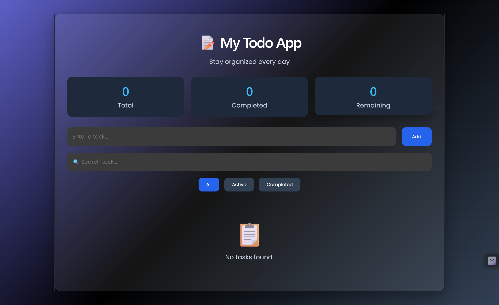
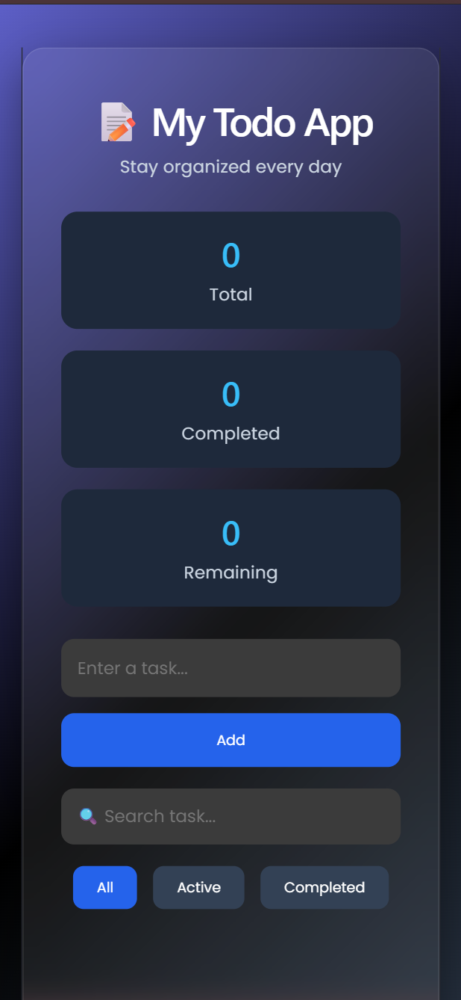

<div align="center">

<h1>✅ TaskFlow — React Todo App</h1>

### Plan clearly. Focus better. Get things done.

A clean, responsive task manager built with **React and Vite**. Create and update tasks, track your progress, search your list, and keep your tasks saved in your browser with Local Storage.

<p>
  
  
  
  
  
</p>

</div>

---

## 📌 Overview

**TaskFlow** is a lightweight Todo application created with React. It offers a straightforward workspace for managing everyday tasks without requiring an account or a backend service.

Add a task, update it when plans change, mark it complete when it is done, and use search and filters to find the items that matter. A statistics section and progress bar provide a quick overview of your workload, while browser Local Storage keeps your list available between visits in the same browser.

> **Project scope:** TaskFlow is a client-side application. Tasks are saved locally in the current browser and are not synced across devices or accounts.

## ✨ Features

- **Create tasks** — add tasks using the input field or press `Enter`.
- **Edit tasks** — update a task without creating a duplicate.
- **Complete or undo** — mark tasks as finished and reopen them when needed.
- **Delete tasks** — remove individual tasks with a confirmation prompt.
- **Clear completed tasks** — remove all completed items after confirmation.
- **Instant search** — find tasks by matching their text.
- **Status filters** — view all, active, or completed tasks.
- **Task statistics** — see total, completed, and remaining tasks.
- **Completion progress** — track your completion percentage with a progress bar.
- **Automatic persistence** — save and reload tasks using the browser's Local Storage API.
- **Creation timestamps** — view when each task was created.
- **Responsive interface** — layouts adapt for desktop, tablet, and mobile screens.
- **Helpful empty state** — clear feedback when there are no matching tasks.

## 🖼️ Screenshots

### Desktop



### Mobile



## 🧰 Tech Stack

| Technology | Purpose |
|---|---|
| **React** | Builds the interactive user interface with functional components. |
| **Vite** | Provides the development server and production build tooling. |
| **JavaScript (ES6+)** | Implements task operations, searching, filtering, and progress calculations. |
| **CSS3** | Handles the visual design, layout, transitions, and responsive styling. |
| **Local Storage API** | Persists task data in the browser. |
| **ESLint** | Helps identify code-quality issues during development. |

## 🚀 Getting Started

### Prerequisites

Install the following on your machine:

- [Node.js](https://nodejs.org/) — use a current version compatible with the Vite version in `package.json`.
- npm — included with Node.js.
- A modern web browser.

### 1. Clone the repository

Replace `YOUR_USERNAME` with your GitHub username and adjust the repository name if yours is different.

```bash
git clone https://github.com/YOUR_USERNAME/react-todo-app.git
```

### 2. Move into the project directory

```bash
cd react-todo-app
```

### 3. Install dependencies

```bash
npm install
```

### 4. Start the development server

```bash
npm run dev
```

Open the local URL printed in your terminal. Vite commonly uses `http://localhost:5173` when that port is available.

## 📦 Available Scripts

| Command | Description |
|---|---|
| `npm install` | Install the project dependencies. |
| `npm run dev` | Start the local development server. |
| `npm run build` | Create an optimized production build in `dist/`. |
| `npm run preview` | Preview the production build locally. |
| `npm run lint` | Run ESLint against the project. |

### Build for production

```bash
npm run build
```

### Preview the production build

```bash
npm run preview
```

## 📂 Project Structure

```text
react-todo-app/
├── public/
│   ├── favicon.svg
│   └── icons.svg
├── screenshots/
│   ├── home.png
│   ├── homep.png
│   ├── mobile.png
│   └── mobilep.png
├── src/
│   ├── assets/
│   │   ├── hero.png
│   │   ├── react.svg
│   │   └── vite.svg
│   ├── App.jsx
│   ├── App.css
│   ├── index.css
│   └── main.jsx
├── .gitignore
├── eslint.config.js
├── index.html
├── LICENSE
├── package.json
├── package-lock.json
├── vite.config.js
└── README.md
```

## 🧠 React Concepts Demonstrated

This project is a practical example of several core front-end concepts:

- Functional React components.
- The `useState` Hook for tasks, search, filters, and editing state.
- The `useEffect` Hook for loading and saving data.
- Controlled form inputs and keyboard event handling.
- CRUD-style operations: create, read, update, and delete.
- List rendering and conditional rendering.
- Derived statistics and progress calculations.
- Browser Local Storage for client-side persistence.
- Responsive styling with CSS media queries.

## 💾 How Task Storage Works

TaskFlow reads the saved task list from Local Storage when the application starts and writes updates whenever the task state changes.

This means:

- Tasks remain available after refreshing or reopening the app in the same browser profile.
- Clearing browser site data or Local Storage can remove saved tasks.
- Tasks are not automatically shared between browsers, devices, or users.
- The project does not send task data to a server.

## 🔮 Future Improvements

Potential next steps for the project include:

- [ ] Add due dates and reminders.
- [ ] Add task priority levels and categories.
- [ ] Add a light/dark theme switcher.
- [ ] Add toast notifications and undo actions.
- [ ] Support drag-and-drop task ordering.
- [ ] Add export and import for task backups.
- [ ] Add optional cloud sync and user accounts.
- [ ] Improve accessibility and keyboard navigation.

## 🤝 Contributing

Suggestions and improvements are welcome.

1. Fork the repository.
2. Create a feature branch:

   ```bash
   git checkout -b feature/your-improvement
   ```

3. Make your changes and test the affected features.
4. Run the checks:

   ```bash
   npm run lint
   npm run build
   ```

5. Commit your changes and open a pull request.

## 📄 License

This project is licensed under the **MIT License**. See the [`LICENSE`](LICENSE) file for details.

## 👨‍💻 Author

**Samyak Dutta**  


---

<div align="center">

**Small steps. Consistent progress. Better days.**

If TaskFlow was useful to you, consider giving the repository a ⭐ on GitHub.

</div>
